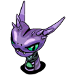
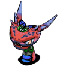
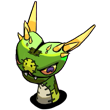
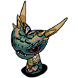
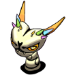
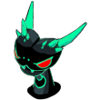
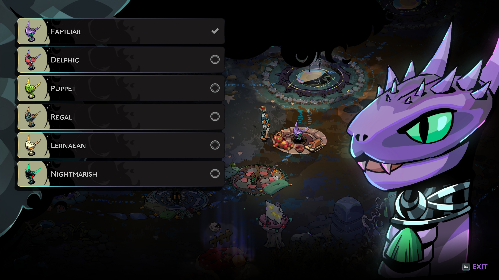
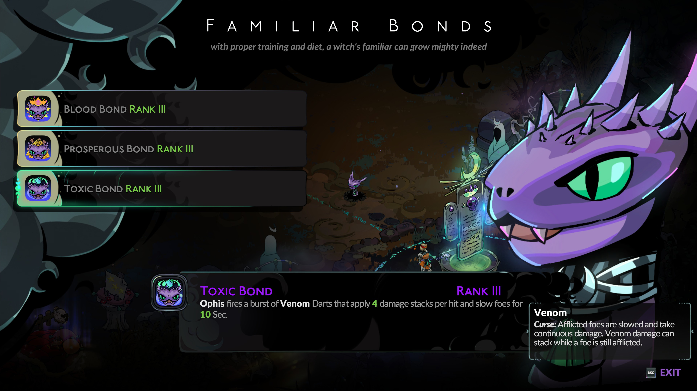
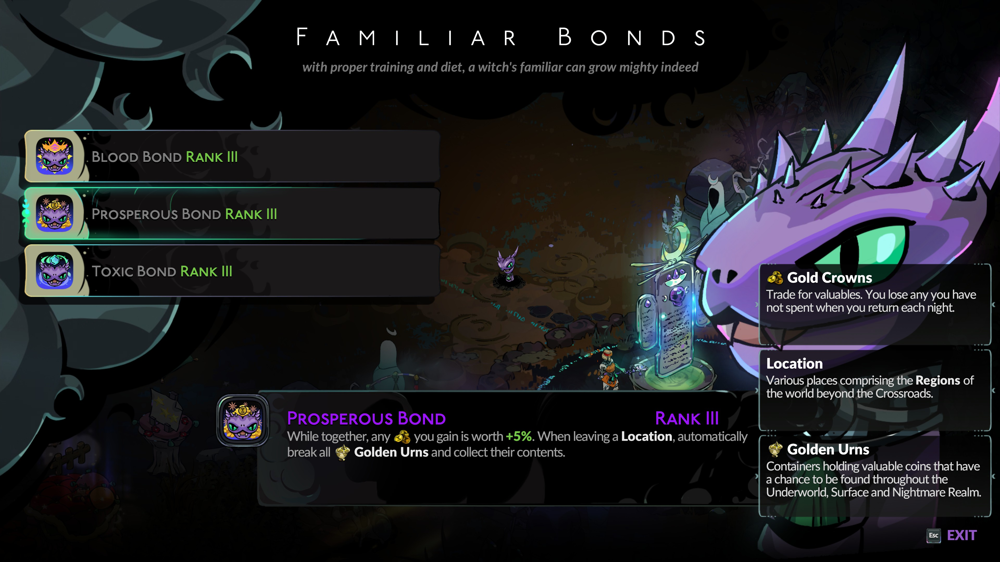
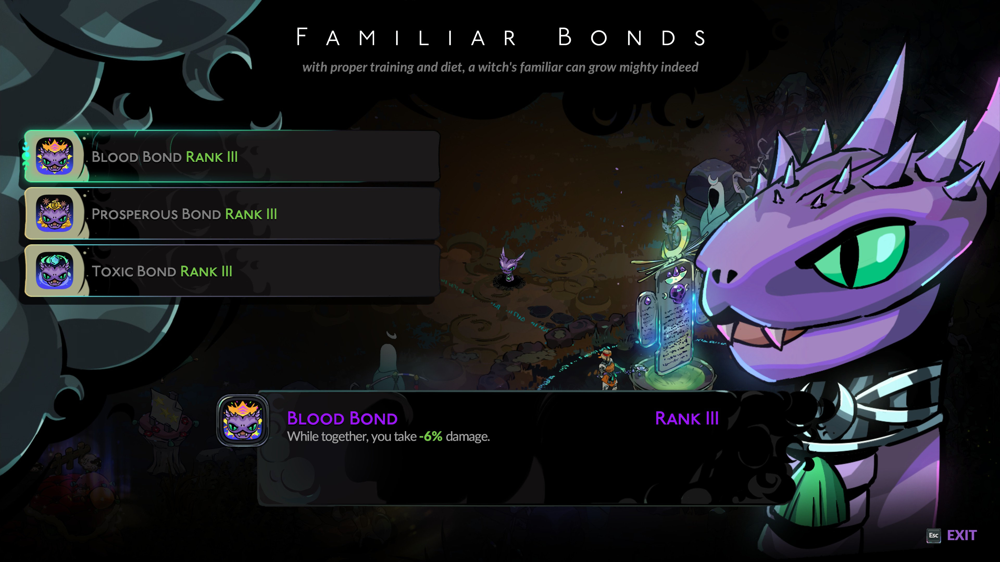

# Dracon Familiar

A Hades II mod that adds a new Familiar, **Ophis** the Dracon, to the game.

The mod is meant to be used together with [Zagreus' Journey](https://www.nikkelhadesmods.com/mods/zagreus-journey) (and will be automatically installed when you download Zagreus' Journey), but can also be used standalone.

When playing with Zagreus' Journey, you can find and bond with Ophis in the Fountain room in the Temple of Styx, otherwise he will automatically appear in the Training Grounds after you perform the "Faith of Familiar Spirits" incantation.

Ophis has the following bonds:
- **Toxic Bond**: Ophis fires a burst of Venom Darts that apply *1* -> *4* damage stacks per hit and slow foes for *6* -> *10* Seconds.
- **Blood Bond**: While together, you take *-3%* -> - *-6%* damage.
- **Prosperous Bond**: While together, any Gold you gain is worth *+4%* -> *+8%*. When leaving a Location, automatically break all Golden Urns and collect their contents.

Ophis also has five alternate forms created by community artist @burn:

<table align="center">
  <tr>
    <td align="center">
      Familiar 
      
    </td>
    <td align="center">
      Delphic 
      
    </td>
    <td align="center">
      Puppet 
      
    </td>
  </tr>
  <tr>
    <td align="center">
      Regal 
      
    </td>
    <td align="center">
      Lernaean 
      
    </td>
    <td align="center">
      Nightmarish 
      
    </td>
  </tr>
</table>

  
  

  
  

*And yes, of course you can pet Ophis.*

## Contributors

- @burn on [Discord](https://discord.gg/KuMbyrN), 

### Contribute Yourself!

You can contribute to this mod by translating the text it adds into your native language!

See the [Contribute a Translation wiki page](https://github.com/NikkelM/Hades-II-HadesBiomes/wiki/Contribute-a-Translation) on the Zagreus' Journey project for more information on what needs translating, and how to do so.
